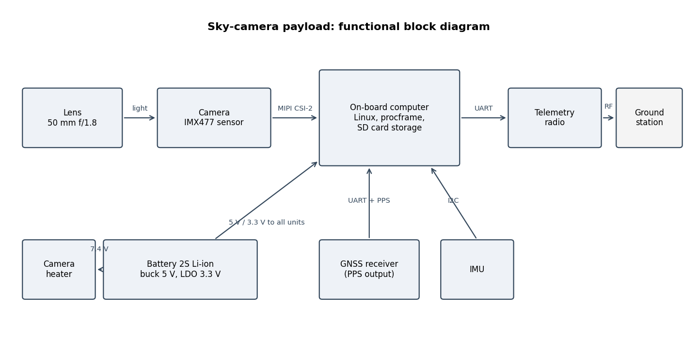
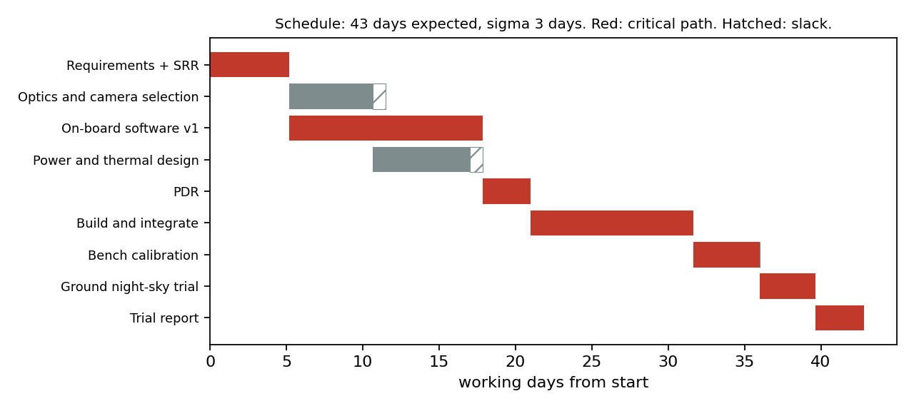

# Sky-camera payload: preliminary design review data package

SKY-PDR-001 rev 0.1, 27 October 2026
# 1 Introduction

## 1.1 Purpose

This document presents the preliminary design of a sky-pointing camera payload and asks the review
board to confirm that the design meets its requirements with acceptable risk, so that detailed design and
the first build can start.

## 1.2 Scope

The payload images star fields from the ground or from a high-altitude balloon, corrects the images on
board, detects stars and the streaks left by satellites crossing the field, and sends a compact list of
detections to the ground while storing every raw frame. It covers the camera, optics, on-board computer,
software, power and timing. The balloon platform, its flight-termination system and the ground station
antenna are outside the scope.

## 1.3 Status of the evidence

The on-board software, the calibration method and the telemetry format exist and have been run end to end.
The camera has not yet been bought, so every performance number in sections 7 and 9 comes from a simulated
sensor and simulated sky. Component values marked TBC are assumptions to be replaced by datasheet values or
bench measurements; they are listed as open items in section 12.

# 2 Documents

| ID | Title |
|---|---|
| SKY-ICD-001 | Interface control document |
| SKY-TP-001 | Ground night-sky trial: plan and procedure |
| SKY-UM-001 | On-board software user manual |
| SKY-TR-001 | Simulated trial report |
| EMVA 1288 Release 4.0 | Standard for characterisation of image sensors and cameras |
| CCSDS 131.0-B | TM synchronisation and channel coding (source of the 32-bit attached sync marker) |
| NASA/SP-2016-6105 Rev 2 | NASA Systems Engineering Handbook (review and verification practice) |

# 3 Mission and requirements

## 3.1 Operations concept

Satellites in low Earth orbit are seen by reflected sunlight, so they are visible against a dark sky only
when the observer is in darkness and the satellite is still sunlit: in the first and last hours of the
night. The payload therefore observes in twilight windows. It takes a 0.2 s exposure every 2 s, processes
each frame within the 2 s, sends the detections over the telemetry radio and writes the raw frame to the
SD card. Calibration frames (darks with the lens cap on, flats of an evenly lit screen) are taken before and
after each session.

## 3.2 Requirements

The thresholds are set by this project, not by a customer; the rationale column justifies each.

| ID | Requirement | Rationale | Verified by |
|---|---|---|---|
| PL-001 | The payload shall detect point sources with at least 2000 electrons of total signal in one exposure with at least 95% completeness. | 2000 e- is about 500 times the sky background per pixel in a 0.2 s exposure (simulated sky) | Test |
| PL-002 | Centroids of those sources shall be accurate to 0.3 pixel rms or better. | a quarter of the PSF sigma (1.2 px); about 1.9 arcsec at 6.39 arcsec per pixel | Test |
| PL-003 | The payload shall detect satellite streaks longer than 50 pixels and report their direction to within 1 degree. | a LEO satellite near zenith crosses about 90 px in 0.2 s | Test |
| PL-004 | Each frame shall be time-stamped to within 1 ms of GPS time. | see SKY-ICD-001 section 5: 1 ms is 7 m along a LEO ground track | Test (open: needs hardware) |
| PL-005 | Detection telemetry shall need less than 9.6 kbit/s. | a low-cost telemetry radio link | Analysis |
| PL-006 | The payload shall store every raw frame for 4 hours of operation. | the raw data is the science product; telemetry is a summary | Analysis |
| PL-007 | Average power from the battery shall not exceed 10 W. | battery mass on the balloon | Analysis |
| PL-008 | Every telemetry packet shall carry a checksum that detects any single-bit error. | corrupted detections must be rejected, not used | Test |

# 4 Architecture

| Unit | Choice | Status |
|---|---|---|
| Optics | 50 mm f/1.8 C-mount lens | TBC: focal length is set by the 6.39 arcsec per pixel plate scale |
| Camera | Sony IMX477 sensor (Raspberry Pi HQ Camera), 1.55 um pixels, 12-bit raw | selected |
| On-board computer | single-board Linux computer with a MIPI CSI-2 camera port | TBC: must meet the processing time in section 6.3 |
| Timing and position | GNSS receiver with PPS output | TBC |
| Attitude | MEMS IMU on I2C | TBC |
| Telemetry | UART radio modem | TBC |
| Power | 2-cell Li-ion battery, 5 V buck converter, 3.3 V LDO | TBC |
| Thermal | camera heater with thermostat | TBC: needs thermal analysis for balloon flight |

# 5 Interfaces

Every interface is defined in SKY-ICD-001: the telemetry packet, the raw frame and calibration file formats,
and the electrical interfaces (camera CSI-2, GNSS UART and PPS, IMU I2C, radio UART).

# 6 On-board software

## 6.1 Processing chain

1. Read the raw 12-bit frame and the calibration products (master dark, normalised flat, bad-pixel mask).
2. Correct: subtract the dark, divide by the flat, replace bad pixels by the median of their good neighbours.
3. Estimate background and noise from the median and the median absolute deviation of every seventh pixel.
4. Group pixels more than 5 noise sigma above background into 8-connected sources; keep sources of 4 or more pixels.
5. For each source compute flux, centroid and second moments. The moments give elongation, angle and length; a source more elongated than 3:1 is flagged as a streak.
6. Write one telemetry packet per frame (SKY-ICD-001 section 2).

## 6.2 Implementation

C11, one source file, no libraries beyond the C standard library and libm. It builds with all warnings as
errors, and a second build with address and undefined-behaviour sanitisers is used in testing. A Python
script reproduces the correction step and agrees with the C output to better than 0.001 DN on every pixel.

## 6.3 Processing time

On a 512 x 512 window the program takes about 21 ms per frame on a laptop processor (Intel i7-1255U,
process start included). The full sensor has 47 times more pixels, and a single-board computer is slower
than the laptop, so the full-frame time on the target computer is unknown and may exceed the 2 s frame
period. This is risk R-01; the mitigation is to process a region of interest or to bin 2 x 2 on board.

# 7 Calibration

The method follows EMVA 1288: photon-transfer pairs give the gain and read noise without knowing the light
level, darks at several exposure times give the dark current, and the variance peak gives the saturation
capacity. On simulated data the method recovers the values the simulator used:

| Quantity | Measured | Simulated |
|---|---|---|
| Gain (e-/DN) | 0.903 | 0.900 |
| Read noise (e-) | 3.09 | 3.00 |
| Dark current (e-/s) | 1.98 | 2.00 |
| Saturation capacity (e-) | 2889 | hard clip 3455 |

The saturation capacity sits below the hard clip because, by the EMVA definition, it is the signal where the
temporal variance peaks, and the brightest pixels in the measurement window clip first. Dynamic range:
936:1 (59.4 dB).

# 8 Budgets

## 8.1 Power

| Load | Rail (V) | On (W) | Duty | Average (W) |
|---|---|---|---|---|
| Camera module (IMX477) | 5.0 | 1.0 | 1.0 | 1.0 |
| On-board computer | 5.0 | 5.0 | 1.0 | 5.0 |
| GNSS receiver | 3.3 | 0.15 | 1.0 | 0.15 |
| IMU | 3.3 | 0.05 | 1.0 | 0.05 |
| Telemetry radio (transmitting) | 5.0 | 1.0 | 0.1 | 0.1 |
| Camera heater | 7.4 | 3.0 | 0.4 | 1.2 |

With the LDO loss (0.103 W) and the buck converter loss (0.711 W at an
assumed 90% efficiency), the battery supplies 8.31 W on average, within PL-007. A 4-hour
session with a 20% margin needs 39.9 Wh, 5393 mAh at 7.4 V. All load
values are TBC; the spreadsheet `budgets/budgets.xlsx` recalculates when they are updated.

## 8.2 Data

| Quantity | Value |
|---|---|
| Full raw frame (12-bit in 16-bit words) | 24.66 MB |
| Raw data stored per hour at one frame per 2 s | 44.4 GB |
| Raw data rate if it were downlinked | 98.6 Mbit/s |
| Detection packet with 60 sources | 981 bytes |
| Detection telemetry rate | 3924 bit/s |

On-board detection is what makes a low-rate radio usable: the detections need 3924 bit/s
(PL-005 met) against 98.6 Mbit/s for raw frames. Four hours of raw frames need about
180 GB, so PL-006 needs a storage device of at least 256 GB (open item A-03).

# 9 Verification

| ID | Method | Where | Status (simulated trial, SKY-TR-001) |
|---|---|---|---|
| PL-001 | Test | TP-001 step 6, simulated trial | met: 99% of bright sources found |
| PL-002 | Test | TP-001 step 6, simulated trial | met: 0.18 px rms |
| PL-003 | Test | TP-001 step 6, simulated trial | met: 3 of 3 streaks, worst angle error 0.25 deg |
| PL-004 | Test | TP-001 step 4 | open: needs the GNSS receiver |
| PL-005 | Analysis | section 8.2 | met: 3924 bit/s |
| PL-006 | Analysis | section 8.2 | open: storage device to be chosen |
| PL-007 | Analysis | section 8.1 | met on assumed values: 8.31 W |
| PL-008 | Test | software test suite | met: a single flipped bit is rejected |

# 10 Risks

| ID | Risk | L | C | Mitigation | Owner |
|---|---|---|---|---|---|
| R-01 | If full-frame processing on the target computer takes longer than 2 s, then frames queue up and detections arrive late. | 3 | 3 | benchmark on the target before CDR; region of interest or 2 x 2 binning | software |
| R-02 | If a bright star touches a streak, then the two merge and the streak's centre and length are biased (seen once in the simulated trial). | 4 | 2 | mask catalogue stars before measuring streaks | software |
| R-03 | If the lens dews up during a night session, then image quality drops for the rest of the session. | 3 | 3 | dew heater; check in the go/no-go list | thermal |
| R-04 | If the camera's real noise is higher than assumed, then faint-source completeness falls. | 2 | 3 | characterise the real camera first (TP-001 step 2) | calibration |
| R-05 | If PPS is lost, then time-stamps drift and streak positions are wrong in time. | 2 | 4 | flag frames without PPS lock in the metadata | electronics |

L = likelihood, C = consequence, each 1 (low) to 5 (high).

# 11 Schedule

The expected duration is 42.8 working days with a standard deviation of 2.9 days.
The critical path runs through the requirements, camera selection, power and thermal design, the PDR, the
build, calibration, the trial and its report; the on-board software has slack.

# 12 Open items and actions

| ID | Action | Due |
|---|---|---|
| A-01 | Buy the camera and lens; repeat the characterisation on the real sensor | before CDR |
| A-02 | Benchmark procframe on the target computer at full frame (R-01) | before CDR |
| A-03 | Choose a storage device of at least 256 GB and check its write speed | before CDR |
| A-04 | Replace every TBC power value with a bench measurement | before CDR |
| A-05 | Thermal analysis for balloon flight | before CDR |
